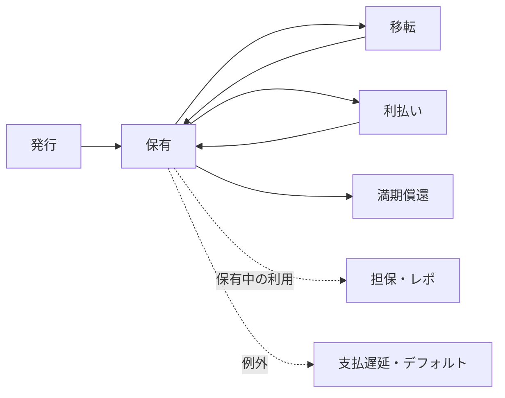

# 債券は、発行して終わりではない

前章では、青葉製作所の債券を「将来の支払いを求める権利」として見ました。その権利は3年間、同じ人が持ち続けるとは限りません。

途中で売却したら、次の利息を受け取るのは誰でしょうか。発行体は、その人をどう知るのでしょうか。

債券には、発行後も仕事が続きます。

## 2.1 発行時のお金と、売却時のお金

発行時には、あなたから青葉製作所に100万円が渡ります。青葉製作所は、その資金を設備投資に使います。新しい債券が発行される場を「発行市場」と呼びます。

1年後、あなたが投資家Bに債券を売るとします。この売買代金を受け取るのは、青葉製作所ではなくあなたです。発行済みの債券を売買する場が「流通市場」です。

お金の行き先を比べると、違いが見えます。

| 場面 | お金を払う人 | お金を受け取る人 | 青葉製作所の元本債務 |
|---|---|---|---|
| 発行 | あなた | 青葉製作所 | 発生する |
| 途中の売買 | 投資家B | あなた | 売買だけでは増減しない |
| 満期償還 | 青葉製作所 | 満期時の権利者 | 支払いにより消滅する |

債券が転売されるたびに、企業が新しい資金を調達するわけではありません。変わるのは、支払いを受ける側です。

## 2.2 「売れた」と「受け渡しが終わった」は別

あなたと投資家Bが売買条件に合意することを「約定」といいます。しかし合意しただけでは、債券も代金も渡っていません。

合意に従って債券と代金を受け渡すのが「決済」です。

ネット通販で注文が成立しても、商品がまだ届いていないことがあります。金融取引でも、合意と履行を分けて見る必要があります。債券の記録を移すことと、代金を払うことをどう結びつけるかは、第6章のDvPで扱います。

## 2.3 利息を払うには、対象者を決める必要がある

青葉製作所が利息を払うには、誰がいくら保有しているかを把握する必要があります。実際の商品では、支払対象を判断する日や取扱方法が決まっています。

売買が利払日の近くで起きると、保有記録の更新と支払対象の判定を整合させなければなりません。売買代金には、利息の経過分を調整する仕組みが使われることもあります。ここでは細かな計算より、「残高を移すだけでは、支払いの処理は完了しない」と覚えてください。

プログラムで自動化するとしても、対象者、基準日時、資金の用意、例外時の処理を決める必要があります。

## 2.4 担保とレポは、保有中の選択肢

すべての債券がレポ取引を通るわけではありません。満期まで持つ人も、途中で売る人もいます。

担保として使う場合は、返済できなかったときの回収に備えて資産を差し出します。この本で主に扱うレポは、債券などの売却と将来の買戻しを組み合わせる現先型です。日本の「レポ」には現金担保付債券貸借取引も含まれます。詳しい区別と契約構造は第7章で説明します。

基本の一生と、その途中での利用を分けて描くと、こうなります。

これは制度を完全に表す図ではありません。本全体で、どの処理の話をしているか見失わないための整理です。

## 2.5 エンジニアが見るべき状態は、残高だけではない

ソフトウェアでは、状態と、状態を変えるイベントを分けることがあります。債券もこの見方で整理できます。

ただし「保有者A」を「保有者B」に書き換えるだけでは不十分です。その債券は移転可能なのか。担保として拘束されていないか。支払対象の判定は済んでいるか。代金の支払いは確定したか。

状態遷移をコードに書く前に、何を条件にして、誰の権限で変更できるかを決めます。金融では、その条件に契約と制度が関わります。

債券をトークンとして発行する機能は、この仕事の入口です。次章では、保有記録と支払いを支える登場人物を配置します。
