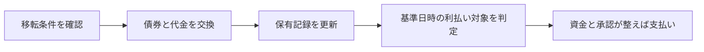

# トークン化で何が変わるのか

債券の残高は、すでにコンピューターで管理できます。それをブロックチェーンに載せ直すと、何が便利になるのでしょうか。

違いが出るのは、残高の表示から、その先の仕事までつながるときです。売る相手の条件を確かめ、代金と交換し、更新された保有記録を次の利払いに使う。このつながりを作ることが、トークン化を検討する理由になります。

**見るべきなのは、トークンを送る速さだけでなく、送った後に残る仕事です。**

まず、そのトークンが何の権利を表すかを確かめてから、仕事の変化を追います。

## 4.1 残高を動かすコードと、権利を移す仕組み

トークンは、デジタルな台帳上で扱う資産や権利の表現です。ブロックチェーン上のプログラムであるスマートコントラクトを使うと、残高の更新や移転条件を実装できます。

たとえば、本人確認を済ませた保有者間だけ移転を許可する設計があります。しかしプログラムが実行されたことだけから、法的な権利移転まで断定することはできません。適用される制度や契約が、その記録と権利を結びつけている必要があります。

エンジニアが見るべきものは、コントラクトの関数だけではありません。「この残高は何を表し、更新によって誰の請求権が変わるのか」という商品側の仕様です。

## 4.2 「債券トークン」でも、中身は違う

大まかに、次の違いを確認します。ここでの区分は、本を読むための整理です。

| 構造 | 投資家が持つもの | 確認する点 |
|---|---|---|
| 債券の権利を直接表す仕組み | 発行体に対する債券の権利 | 台帳と権利移転の制度上の関係 |
| 既存債券を保有する主体が別のトークンを発行 | 保有主体などに対する契約上の権利 | 裏付け資産、分別、償還、破綻時の扱い |
| 債券で運用するファンドの持分をトークン化 | ファンドの持分・受益権など | 運用内容、費用、払戻し条件 |

ファンドが国債を保有していても、投資家が国に直接支払いを請求できるとは限りません。国債と、その国債を保有するファンドの持分は、異なる権利です。

また、既存の振替制度と連携する設計もあります。オンチェーンの記録だけで移転が完結するのか、既存台帳の更新が必要なのかを確かめます。

この区別をしないと、商品名に「国債」が入っているだけで、信用リスクや償還条件まで同じだと誤解してしまいます。

## 4.3 共有した記録に、処理をつなぐ

青葉製作所の債券を、あなたから別の投資家へ売る場面を考えます。次の表は、処理を別々に管理する設計と、共通の記録を使う設計の比較例です。現在の金融業務がすべて左側の方法だという意味ではありません。

| 仕事 | 処理を別々に管理する設計 | 共通の記録と処理を使う設計 |
|---|---|---|
| 売れる相手かを確かめる | 販売側の顧客情報と、移転先の条件を照合する | 確認済みの資格情報を移転の条件として参照する |
| 債券と代金を渡す | 証券と資金のシステムへ指図し、結果を対応させる | 双方の準備が整ったときだけ受渡しを確定させる |
| 次の利払い対象を決める | 更新された保有情報を支払対象の一覧へ反映する | 共通の保有記録から基準日時の対象者を判定する |

たとえば、債券は新しい投資家へ移ったのに、利払い用の一覧には以前の保有者が残っていたら、訂正が必要です。保有記録と支払対象の判定がつながっていれば、別の一覧へ反映し直す工程を減らせる可能性があります。

図は設計例です。共通の記録を使っても、発行体は利息の資金を用意し、税務や例外処理の担当者は必要な対応を行います。

既存のデータベースとシステム接続でも、こうした自動化は可能です。ブロックチェーンを選ぶ追加の理由は、複数の組織が、誰のどの記録を根拠に処理を進めるかという点にあります。共通のルールで更新を確かめられれば、組織ごとに結果を突き合わせる負担を減らせるかもしれません。

その代わり、参加者の権限、情報を見せる範囲、更新や障害時のルールを共同で決めます。一社の中だけで十分に処理できる業務なら、既存システムを直す方が適する場合もあります。

## 4.4 速い決済にも、必要な資金がある

同時決済、即時決済、24時間稼働は、別々の性質です。同時決済は債券と代金の受渡しを結びつけること。即時決済は処理のタイミング。24時間稼働は利用できる時間の話です。

日本の国債市場には、すでに債券と資金を結びつけるDvPの仕組みがあります。トークン化によって初めて同時決済が生まれる、という説明は適切ではありません。[日本銀行「DVPとは何ですか？」](https://www.boj.or.jp/about/education/oshiete/kess/i17.htm)

また、すべてを即時に決済するなら、その時点で資金を用意する必要があります。複数の支払いを差し引く仕組みを変えると、事前に必要な資金量が増える場合もあります。速度だけで費用対効果は決まりません。

## 4.5 何が減るかを、処理ごとに確かめる

トークン化の提案を読むときは、「便利になる」を次の問いに置き換えてみてください。

- どの台帳間の照合が減るか。
- どの承認や受渡しの待ち時間が減るか。
- 誰がいつ資金を用意する必要があるか。
- 誤処理や未払いの際に、誰が復旧を引き受けるか。

改善の対象が具体的になれば、導入費用や新しい運用負担と比較できます。

第I部では、債券を権利として捉え、発行後の処理と担当者を分けました。第II部では、日本国債を担保として使い、資金を調達する場面に進みます。画面の残高を、支払いに使える資金へ変えるには何が必要なのか。そこにレポ取引の役割があります。
