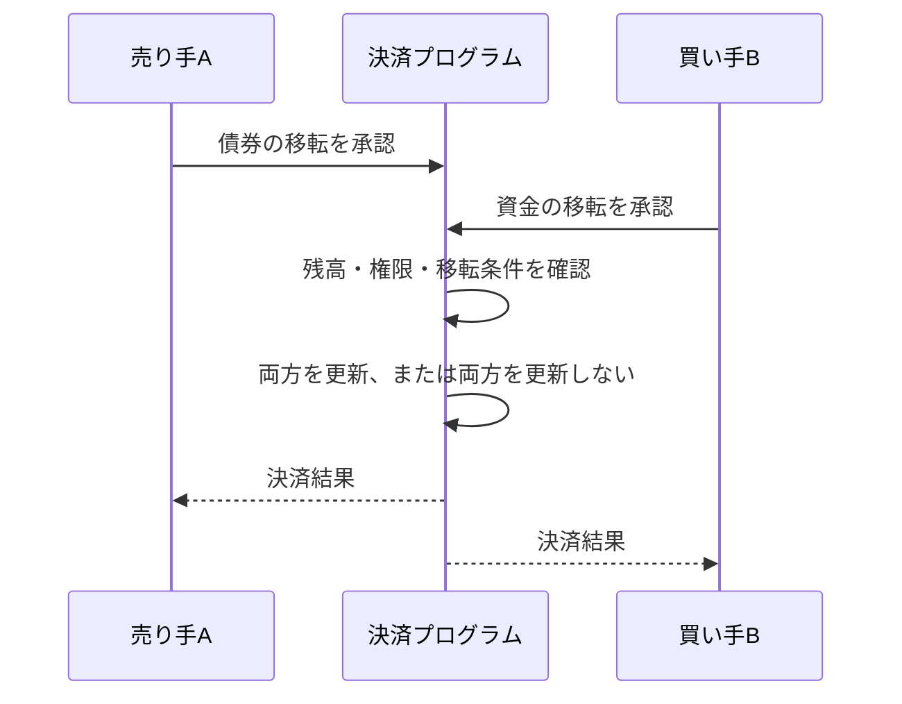

# 債券とお金を交換する――DvPの設計

Aが国債を渡しました。しかしBから代金が届きません。

合意どおりに取引するつもりでも、相手の破綻や処理の問題で、片側だけが完了する可能性があります。この問題に対応するのがDvPです。

## 6.1 片方だけ渡すことを防ぐ

DvPはDelivery versus Paymentの略です。証券の受渡しと資金の支払いを結びつけ、対価を受け取れないリスクを防ぐ決済の仕組みです。

「同時」といっても、単に同じ秒に二つの処理を始めることではありません。片方だけが確定しないように、処理を条件で結びつける点が重要です。

日本国債には既存のDvPがあります。日本銀行は、国債DvPに加えて、その決済に必要な日中資金を供給する同時担保受払機能も説明しています。[日本銀行「DVPとは何ですか？」](https://www.boj.or.jp/about/education/oshiete/kess/i17.htm)

## 6.2 同じ台帳で交換するとき

債券トークンと資金トークンを同じ基盤で扱う場合、双方の残高と移転条件を確認して、一つの処理にまとめる設計ができます。

この「両方成立するか、どちらも成立しないか」という性質がアトミック性です。図は設計例であり、あらゆるトークン取引がこの性質を備えるわけではありません。

## 6.3 資金トークンの中身を確認する

資金側にトークン化預金を使うなら、銀行に対する預金の権利と、利用できる相手や時間を確認します。ステーブルコインを使う場合も、発行者、裏付け、償還方法を確認します。

Bが受け取るのは、どの主体に対する、どのような権利でしょうか。Bの次の支払い先は、そのトークンを受け入れるでしょうか。

画面上の「円」だけでは、資金の使い道まで判断できません。受け取った後に銀行口座への換金が必要なら、その処理も決済設計の一部になります。

## 6.4 コードの成功と、法的な確定

取引が台帳に記録されたことと、資金や証券の受渡しが法的に最終確定し、取り消せなくなることは分けて確認します。決済の最終的な確定性をファイナリティと呼びます。

チェーンが分岐した場合、管理者が緊急停止した場合、誤ったアドレスへ送った場合に、何を最終的な記録として扱うか。技術仕様に加えて制度と契約が必要です。

別々の台帳をつなぐ場合には、片側の停止や確定タイミングの違いも問題になります。同一台帳で成立した設計を、そのまま複数チェーンに持ち出せるとは限りません。

## 6.5 DvPが解決する範囲

DvPで受渡しを結びつけても、買い手に資金がなければ取引は完了しません。発行体の信用リスク、資産の価格変動、資金不足、システム障害も別途扱います。

即時決済では、その都度資金を用意する必要があります。複数の支払いを差し引いて必要額を減らす「ネッティング」と、個々の取引を決済する方法では、資金需要が異なります。

どれだけ速く交換できるかに加えて、何を交換し、いつ資金を用意し、どこで確定するかを見る。次章のレポは、この交換を往復で行う取引です。
