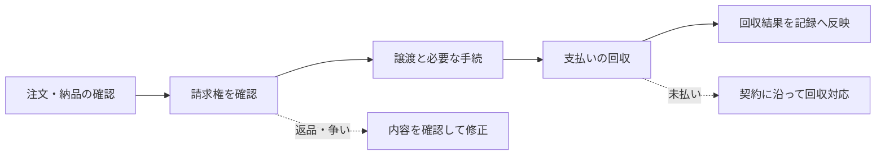

# 売掛債権――「請求書をトークンにする」の難しさ

青葉製作所が、取引先の緑川商事へ部品を納めました。代金100万円を受け取るのは翌月です。しかし材料費は今月中に支払わなければなりません。

この100万円を受け取る権利を、別の会社に売って先に資金を得る方法が考えられます。以下は仕組みを説明する架空例です。価格、期限、登場企業は実際の商品条件ではありません。

社債との違いは、資金を返す約束を新しく発行するのではなく、商取引から生まれた請求権を使う点です。

## 10.1 請求書と、支払いを求める権利

商品を売り、後で代金を受け取る権利を、ここでは売掛債権と呼びます。請求書は金額や支払先などを伝える書類ですが、そのファイルがあるだけで、書かれた権利が実在するとは限りません。

青葉製作所の例なら、注文はあったのか、部品は納められたのか、代金について争いはないかを確かめます。返品や値引き、すでに行われた支払いも、回収できる金額に関わります。

請求書の内容を改ざんされにくい形で記録できても、記録する前の取引が正しかったかは別に確認します。

## 10.2 誰に支払えばよいかを、相手にも伝える

青葉製作所が資金提供会社Cへ売掛債権を譲ったとします。緑川商事から代金を受け取る側を変える取引です。

ここでは、当事者間で譲渡に合意することと、その譲渡をほかの相手にも主張できるようにすることを区別します。後者のための条件を「対抗要件」と呼びます。

日本の債権譲渡では、代金を払う債務者に対する対抗要件と、競合する譲受人など第三者に対する対抗要件を分けます。法人の金銭債権について使える債権譲渡登記も、登記だけで債務者への対抗要件まで自動的に整う制度ではありません。法務省は、登記事項証明書を交付した通知や、債務者の承諾による方法などを説明しています。[法務省の制度説明・Q&A](https://www.moj.go.jp/MINJI/minji06_00184.html)

トークンをCへ送るだけでは、緑川商事の支払先を確定させるための手続が済んだとはいえません。誰が通知し、何を証拠として保存するかまで設計します。個々の契約や譲渡制限の扱いは、適用法と契約条件に沿って確認します。

## 10.3 同じ請求権を、別の場所でも売っていたら

同じチェーン上のトークンを二重に使えない設計は可能です。しかし青葉製作所が、同じ売掛債権を別の会社へ、別の契約で譲っていたらどうでしょうか。

チェーン内で二重使用を防ぐことと、チェーン外の二重譲渡を見つけることは、同じ仕事ではありません。

法務省も、債権譲渡登記は債権の実在や、譲渡が実際に行われたことまで証明するものではないと説明しています。[法務省Q&A](https://www.moj.go.jp/MINJI/minji06_00184.html)

取引先との確認、契約、登記などの証拠、回収口座の管理を組み合わせる必要があります。トークンの供給量が正しくても、その外側の請求権が正しいとは限りません。

## 10.4 回収したら、残高をどう変えるか

緑川商事が100万円を支払った後も、トークンが「未回収100万円」のまま残っていたら、同じ支払いを再び求める誤処理につながります。

回収口座への入金を誰が確認し、どの請求権への支払いかを判断して、記録を更新するのか。自動化する場合も、銀行の入金情報と請求権を対応させる必要があります。

一部だけ支払われた場合や、返品によって請求額が減った場合には、単純な「未払い／支払済み」の二択では足りません。この例では、請求額、回収額、争いのある金額を分けて管理する設計が考えられます。

図は本章の架空例を整理したものです。実際の事業では、債権を直接譲るのか、信託や別の発行主体を介して投資家に異なる権利を渡すのかによっても設計が変わります。

## 10.5 価値が出るのは、確認と回収までつながるとき

売掛債権では、権利は商取引の代金請求権、記録は契約・納品・譲渡・回収の証拠、資金は先に受け取る代金と後の回収金です。責任には、請求権の確認や回収を誰が担うかが含まれます。

青葉製作所が助かるのは、材料費の支払いに間に合うよう資金を得られる場合です。Cが使い続けたいのは、確かな請求権を確認でき、回収状況を追える場合です。

トークンを発行する機能に加えて、この二人の業務を結び付けることが、事業としての検討対象になります。

次章は地方債です。支払う主体が自治体になると、資金の使い道と、参加する住民との関係も変わります。
